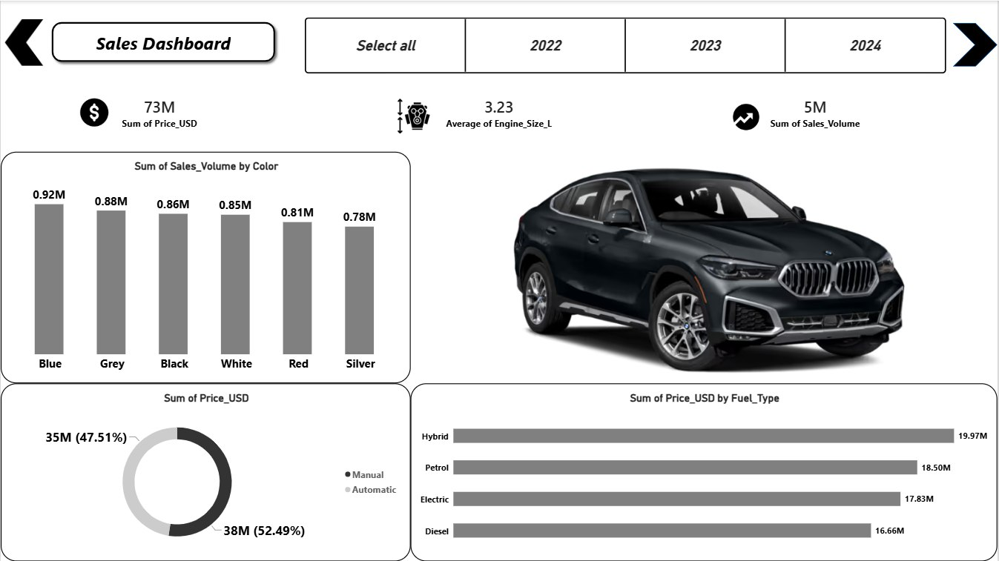
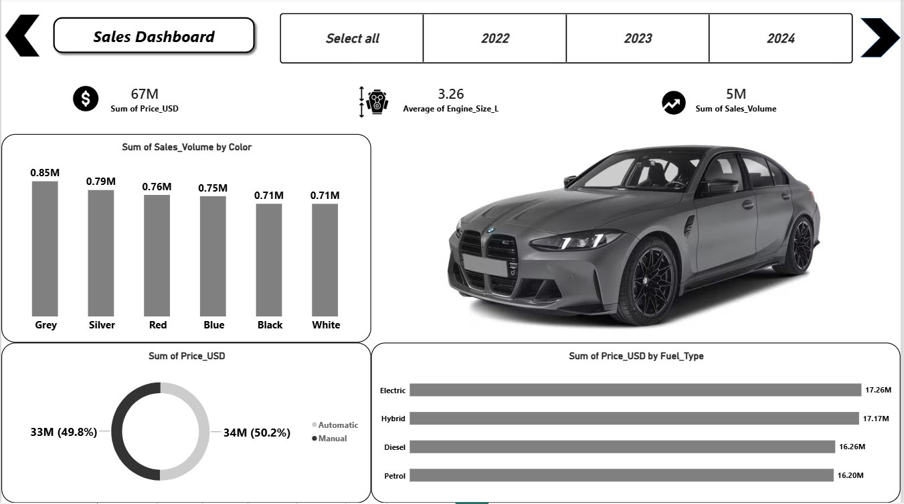
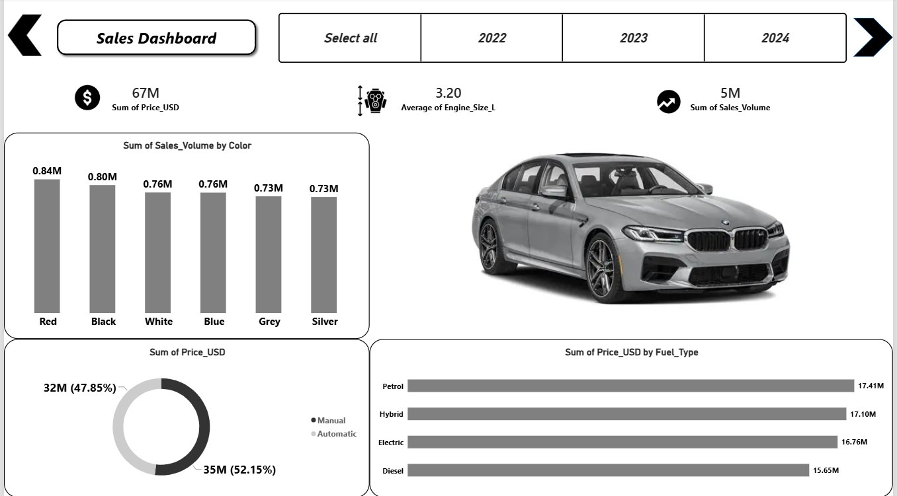
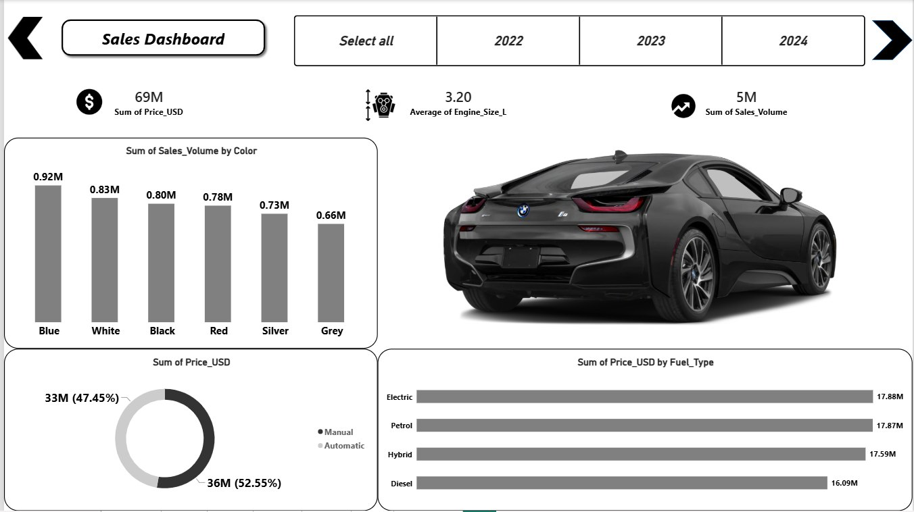
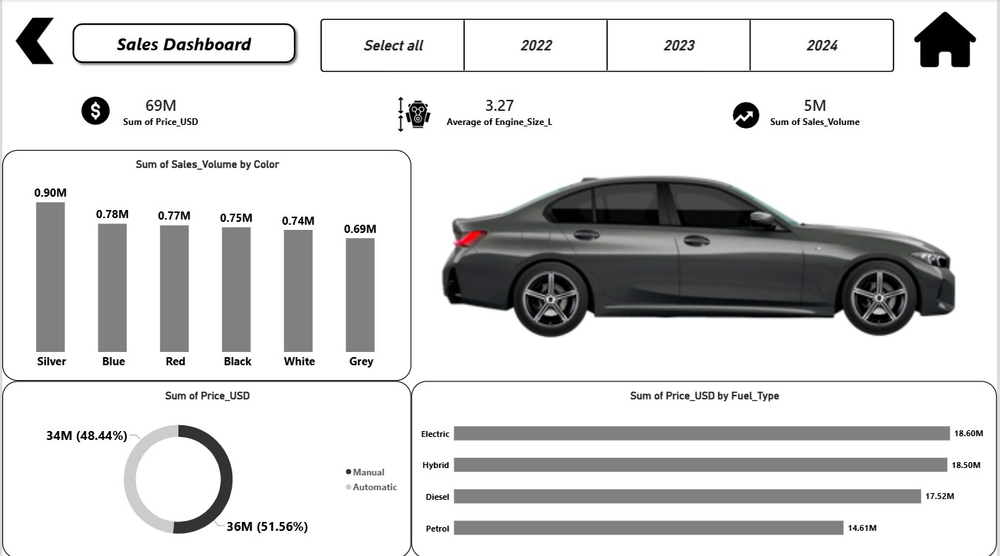

# 🚗 BMW Cars Analysis Dashboard

## Project Overview
This project is an interactive Power BI dashboard for exploring and analyzing different BMW car models.

## Dashboard Pages
The dashboard contains 7 pages:
- Home
- BMW X3
- BMW X6
- BMW M3
- BMW M5
- BMW i8
- BMW 3 Series

## Tools Used
- Microsoft Power BI

## Dashboard Preview

### Home

### BMW X3

### BMW X6

### BMW M3

### BMW M5

### BMW i8

### BMW 3 Series

## How to Use
1. Download the PBIX file.
2. Open it using Power BI Desktop.
3. Explore the dashboard pages.

## Author
Alaa Essam
