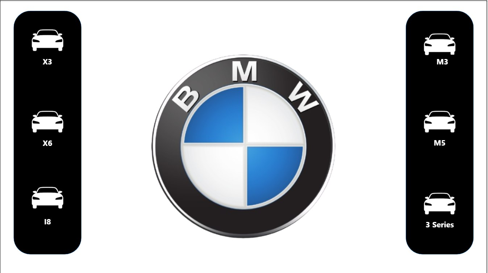
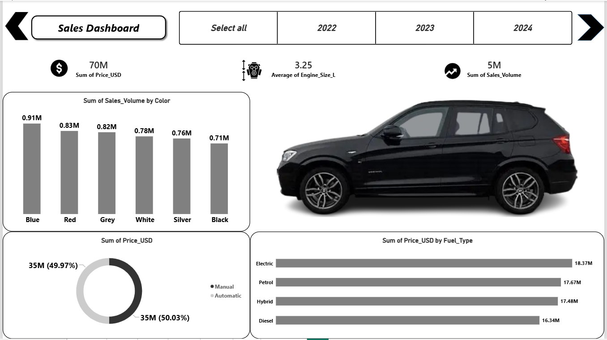

# 🚗 BMW Cars Analysis Dashboard

## 📌 Project Overview

This project presents an interactive BMW Vehicle Sales Analysis Dashboard built using Microsoft Power BI.

The dashboard provides insights into vehicle sales performance, pricing, fuel types, car colors, and different BMW models.

It aims to transform vehicle sales data into meaningful visual insights to support better business understanding and data-driven decisions.

## Dashboard Pages
The dashboard contains 7 pages:
- Home
- BMW X3
- BMW X6
- BMW M3
- BMW M5
- BMW i8
- BMW 3 Series

## Tools Used
- Microsoft Power BI

## Dashboard Preview

### Home

### BMW X3

### BMW X6

### BMW M3

### BMW M5

### BMW i8

### BMW 3 Series

## 🔍 Analysis Areas

- BMW sales volume analysis.
- Vehicle price analysis.
- Sales distribution by fuel type.
- Car color analysis.
- Comparison between BMW car models.
- Analysis of vehicle transmission types.

## 📥 Download & How to Use

[Download BMW Power BI Dashboard](Dashboard/BMW_Cars_Dashboard.pbix)

### Steps:
1. Download the PBIX file.
2. Open it using Microsoft Power BI Desktop.
3. Explore the dashboard pages and interactive filters.
## 🎯 Project Objectives

- Analyze BMW car sales data.
- Explore different BMW car models and their prices.
- Understand sales distribution by fuel type and transmission.
- Present key data in an interactive Power BI dashboard.
- Make the data easier to understand through visualizations. 

## Author
Alaa Essam
